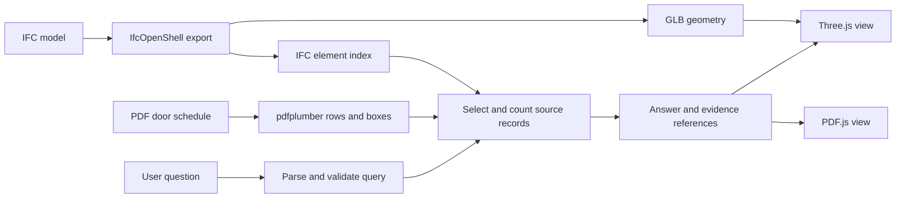

# Blueprint Evidence product and technical design

The main demo should start with a question about a real building and end with the judge clicking the object that proves the answer. The strongest version of this idea is a quantity assistant with two ways to verify a result. On a BIM model, the answer selects the actual IFC elements in a live 3D view. On a PDF, the answer links to the exact schedule rows. A site engineer can check the source without repeating the search by hand.

## Product choices

The first user is a site engineer or quantity surveyor checking a door or window count before a takeoff or site walk. A question such as “How many doors are on the second storey?” needs an answer, a clear scope, and a way to inspect the objects. The interface should show the source building or sheet, the selected storey or filter, the count, and the objects or rows that contributed to it. If a floor label could refer to multiple levels, offer the model’s own storey names. For example, label Esplanades floors with their native names such as `2.korrus` in the selector and in the answer.

The 3D scene should serve as evidence. Open with the complete building. After a query, move the camera to the relevant floor, mute the surrounding geometry, and color the matches. Show a compact result list beside the scene. Selecting a row focuses the corresponding object, and selecting a mesh opens the matching record. Use the same interaction for a PDF row and its page highlight. A full-building count can group the evidence by storey so hundreds of results remain inspectable.

The first demo covers quantities and source locations for doors and windows. A later iteration can compare revisions or flag differences between a PDF schedule and an IFC model when the files come from the same project and the IDs can be matched. The A-801 and Esplanades examples come from separate projects and should appear as separate examples in the demo.

## What the official samples support

| Input | Observed result | What it supports |
| --- | --- | --- |
| Esplanades IFC, `bsc-esplanades_1807-ep-ar-v18.ifc` | 211 `IfcDoor` elements and 297 `IfcWindow` elements. Storey `2.korrus` contains 42 doors and 60 windows. | Whole-building and storey-level queries from the IFC spatial hierarchy. |
| GLB exported from Esplanades | A geometry export filtered to main building components produced a roughly 4.3 MB GLB with 1,447 mesh nodes. All 211 door and 297 window GUIDs matched exported node names. | The evidence can be joined to actual mesh objects. Measure browser load time, selection behavior, and frame rate separately. |
| A-801 Door and Finish Schedules PDF | 38 distinct door marks, 14 A1 doors, 9 B1 doors, and two marks with a blank door type. All seven tested counts matched `questions.jsonl`. | A PDF viewer can highlight the rows used to count. The total can include a door even when its type is blank. |

These are local data and export checks on the official samples. They establish the initial demo cases. The evaluation below covers browser behavior and unfamiliar projects. [Stoa challenge and data](https://hackjunction.app/participate/45/challenges/335)

## Data flow and stack

**IFC ingestion.** Use Python and IfcOpenShell to read each element’s `GlobalId`, class, display name, containing `IfcBuildingStorey`, and any properties needed by the demo. Identify levels by their IFC IDs. Preserve elements without a resolved storey in the whole-building index and show them separately when listing by floor. Export the GLB once per model version and keep a model-specific map from IFC GUIDs to browser objects. Verify the map after loading because Three.js may sanitize or uniquify object names. Keep a stable copy of the original exported name or an explicit mapping from the glTF node index to the IFC GUID. Check every supported door and window resolves before enabling the evidence view. [IfcOpenShell geometry export](https://docs.ifcopenshell.org/ifcopenshell-python/geometry_processing.html) · [Three.js GLTFLoader](https://threejs.org/docs/pages/GLTFLoader.html)

**3D viewer.** Use TypeScript and Three.js with `GLTFLoader` and `OrbitControls`. Add floor isolation, fit-to-selection, visible highlights, and pointer picking. Start with neutral materials and a single highlight color. Use the result list as a second way to select elements, especially where a wall obscures a door. Measure the first render and interaction on a teammate’s laptop and check that clearing a query restores the whole model. A pre-exported GLB makes geometry loading independent of the model API. [Three.js camera controls](https://threejs.org/docs/pages/OrbitControls.html)

**PDF ingestion.** Use pdfplumber to extract `Door Number`, `Door Type`, page number, and row bounding boxes from digital PDFs. Normalize whitespace and case before matching type codes. Keep blank values as missing. Count distinct door marks within the selected schedule, and identify duplicates if sheets overlap. Render in PDF.js and translate evidence boxes through the page’s viewport, including rotation and zoom. Verify the rectangle covers the same row after a page resize and after switching between PDF and 3D examples. [pdfplumber](https://github.com/jsvine/pdfplumber) · [PDF.js examples](https://mozilla.github.io/pdf.js/examples/index.html)

**Query and evidence.** A small FastAPI service can expose query and asset endpoints. Use rules for common requests and an optional model to interpret free-form wording. Resolve the model, sheet, floor, element class, and type against known values before executing a query. Derive the count and display evidence from the same records. An IFC evidence item needs the model ID and `GlobalId`. A PDF evidence item needs the document ID, page, bounding box, and door mark. The exact endpoint and field names are proposed implementation decisions for the team’s contract review.

**Model integration.** Use the hosted `nvidia/nemotron-3.5-super-vl-120b-a12b` model for a measured fallback on a hard document. A good first case is a sheet with two plausible schedules or a crop with a header that the deterministic parser fails to identify. Ask Nemotron to select a candidate table or map its columns, validate the response, and run the count from the source records. An incomplete or unverifiable result should identify which region needs review. CPU extraction and browser rendering are enough for the verified samples. Training becomes relevant if held-out image-only sheets show a recurring localization error and the team can obtain box annotations. The provided question answers are suitable for checking counts. [NVIDIA hosted model](https://build.nvidia.com/nvidia/nemotron-3.5-super-vl-120b-a12b)

## Evaluation against the judging criteria

| Stoa criterion | What to show | How to measure it |
| --- | --- | --- |
| Accuracy, 25% | Correct counts and explicit scope | Compare against the provided answers for known questions. Add one held-out project with different table headers or storey naming. Split by project so translated variants of the same question stay together. Record incorrect answers and unanswered questions separately. |
| Evidence visualization, 25% | An answer the judge can inspect | Check that count, list, and highlights agree. Manually verify several highlighted IFC objects and PDF rows. Confirm that changing floor or type refreshes both the count and the evidence. |
| Creativity, 25% | Natural-language questions drive the actual building view | Let a judge change the floor and object type and click a highlighted item. Show an example with missing type information and explain what can still be counted. |
| Low inference cost, 25% | The ordinary path runs without a vision-model call | Run the same held-out questions through a full-page model baseline and the structured pipeline. Record exact-match accuracy, model calls, token cost where available, and end-to-end latency. Separate one-time file preparation from per-query time. |

Count evidence hits by unique ID and verify there are no duplicates. For PDF queries, test a total with missing types and a filtered query with no matches. For IFC queries, test a whole-building count, two storeys, an ambiguous floor label, and a requested type absent from the model. Log the dataset, model/version, query, result, latency, and evidence count for each evaluation. [Stoa judging criteria](https://hackjunction.app/participate/45/challenges/335)

## Build order and team handoff

1. **Connect BIM data to a rendered building.** One teammate prepares the IFC index and GLB. A second builds the browser scene and consumes a small sample result. The first integration is complete when asking about `2.korrus` highlights exactly 42 doors and clicking a door reveals its IFC identity. Repeat with 60 windows.
2. **Add PDF evidence and natural-language queries.** One teammate handles PDF extraction and coordinate verification while another builds query interpretation and the evaluation script. First demonstrate 14 A1 doors, then 38 total with two untyped entries. Use one shared answer-and-evidence shape across the viewers.
3. **Evaluate before adding integrations.** Hold out a second project and compare with the direct model baseline. Implement the highest-value correction for an observed error. Deploy a working demo, save a local fallback for the pitch, and capture a short recording with both evidence views.

The 3D view and IFC exporter can start independently with sample data. The shared decisions are which storey and element IDs the query returns, how a match is shown in each viewer, and how each answer identifies the source version. Assignments above are proposed workstreams for four people.

## Sponsor integrations and extensions

- **Best Use of Codex.** Keep concrete examples of how Codex helped with implementation or verification, such as the IFC export investigation, an evidence mapping check, or the evaluation runner. Show the change and the result it enabled. [Codex challenge](https://hackjunction.app/participate/45/tech-challenges/49)
- **Best Use of Nemotron.** Submit if the specified vision model resolves a demonstrated hard case in the working pipeline. Show the input crop, its structured output, and the evidence the product returned. Include the required short description of the model and its contribution. [Nemotron challenge](https://hackjunction.app/participate/45/tech-challenges/46)
- **Modal or Verda.** Modal fits a live demo with parallel evaluation or document processing. Verda fits a measured batch inference or compute job and asks teams to share a summary link in its Discord channel. Pick the service that supports the workload actually demonstrated. [Modal challenge](https://hackjunction.app/participate/45/tech-challenges/40) · [Verda challenge](https://hackjunction.app/participate/45/tech-challenges/56)
- **Meta.** A field reviewer can use a simulator prototype to select an element, see its approved specification, and flag a discrepancy. A glasses client can call the same evidence service. Confirm eligibility with the Meta mentor for a simulator-only entry. [Meta challenge](https://hackjunction.app/participate/45/challenges/342)
- **AfterQuery.** A separate evaluation could give an agent two drawing revisions and an approval register, then grade which revision it used and whether it cited the right rows. It can reuse sample data and evidence tools. Entry requires a reproducible environment and a stronger reference run with the supplied harness, so first test whether a measurable gap exists. [AfterQuery challenge](https://hackjunction.app/participate/45/challenges/328)

## Submission materials

Use the first 30 seconds to show a live storey query and the 3D highlight. Let the judge verify one object, then show the PDF result with the missing type entries. Finish with the measured comparison and supported scope. Include a demo URL, source repository, short video, and sample instructions. Verify the URLs from another machine before final submission and keep model API credentials outside the public repository. [Junction participant guide](https://hackjunction.app/participate/45/guide)
