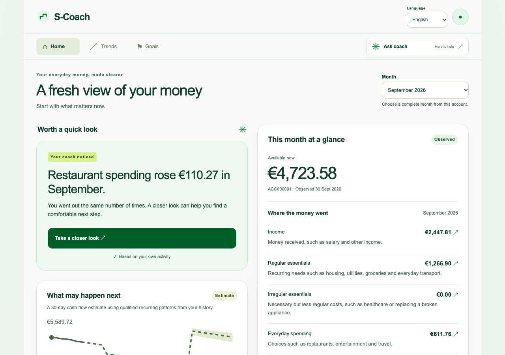
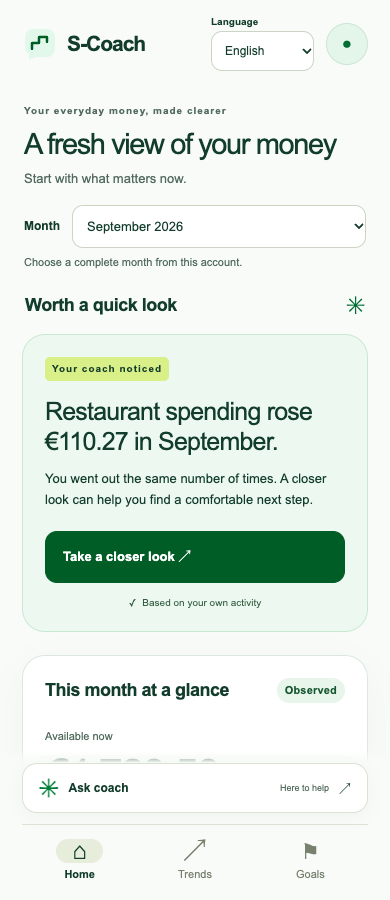
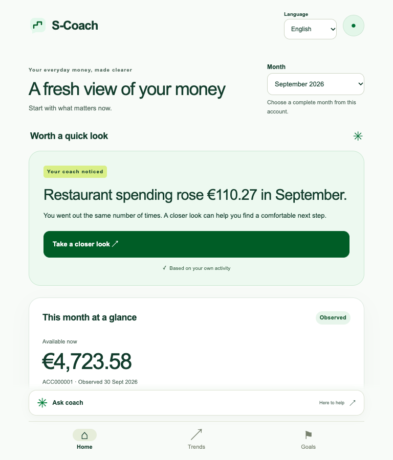
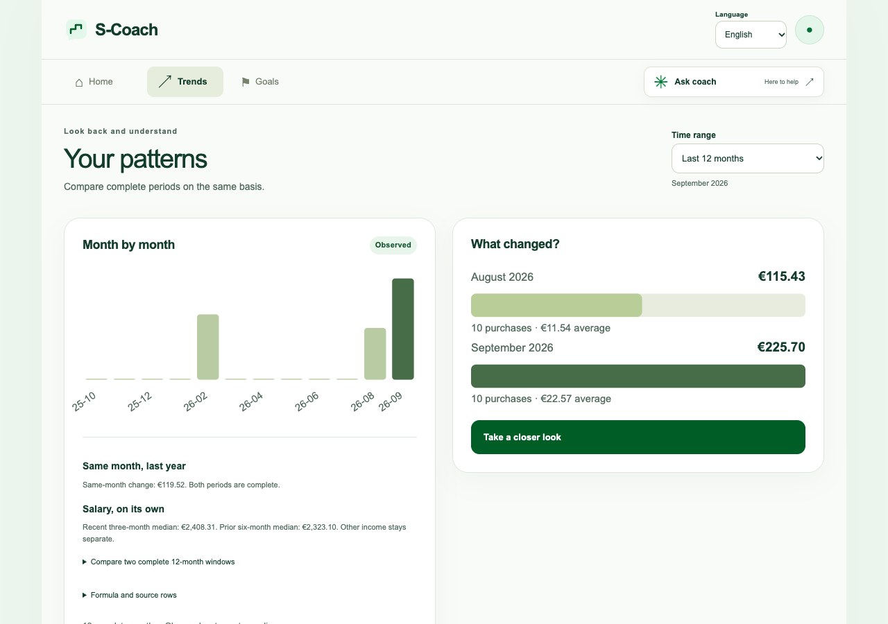

# S-Coach — talk with your money

S-Coach is a mobile-first, desktop-adaptive financial coach for the Junction 2026 S-Pankki challenge. It turns the official synthetic banking dataset into plain-language answers, explainable visualizations, editable planning scenarios, and goal guidance.

The prototype runs locally by default. It uses no real customer data, makes no payments or credit decisions, and requires no third-party package for its core flow.

**Current status:** the responsive demo and deterministic calculations are implemented. Natural-language scope interpretation is still incomplete; see [Known limitations](#known-limitations). A passing calculation test does not prove that the coach understood a question correctly.

## Interface examples

Screenshots from the running prototype's 14 November 2026 browser walkthrough, using the official synthetic demo data. These are actual interface captures, not design mockups. The same page adapts to each viewport.

### Desktop overview



### Phone and tablet

| Phone · 390 px | Tablet · 768 px |
|---|---|
|  |  |

### Trends and comparison



To explore the interfaces yourself, [start the app](#quick-start), then open the [local device preview](http://127.0.0.1:8088/device-preview.html). The screenshots are static; the preview includes interactive phone, tablet, and desktop presets.

## What the prototype demonstrates

- A financial overview with income, regular essentials, irregular essentials, everyday spending, saving/transfers, balance, trends, and selectable periods.
- Guided coach topics and supported free-text patterns in English, Finnish, and Swedish. Optional Gemini can interpret additional query languages; live multilingual behavior has not been verified on this machine.
- Account statistics calculated locally from explicitly selected rows. Correct arithmetic depends on selecting the intended category and period.
- Restaurant totals, dining-out reduction scenarios, a neutral spender profile, and safe-to-spend. The partner's narrower taxi question remains a known defect.
- A seven-day safe-to-spend estimate with reserve, qualified recurring outflows, historical spending buffer, assumptions, and source references.
- A pattern-based 30-day cash-flow preview with editable assumptions and historical variation rather than false certainty.
- Universal goals for a buffer, trip, vehicle, home, large purchase, or custom target.
- Observed investment transfers only; no invented holdings, returns, risk, or product advice.
- Optional historical mortgage context for the linked synthetic persona, never a current approval or affordability assessment.
- Explicit tax-record evidence, a user-declared tax set-aside scenario, and a separate estimated VAT-inside-purchases lens.
- A responsive phone/tablet/desktop experience and an unlinked local viewport preview utility.

## Quick start

Run all commands below from the **repository root**, `Junction_Hannah_family/`, in bash or zsh. This application is self-contained under `s bank/`; the root Stoa backend and `web/` server are not needed.

### Requirements

- Python 3.10 or newer, with the standard-library `sqlite3` module. The current environment was checked with Python 3.13.12.
- A modern browser. Node.js is used for JavaScript checks in the test suite, not for running the app.
- No `pip install`, `npm install`, system-package installation, or Gemini key is needed for the core demo.

### Start with the existing demo database

If `s bank/var/scoach.sqlite3` is already present and imported, reuse it. **Do not rebuild or replace it just to start the app.**

```bash
PYTHONPATH="s bank" python3 -m scoach \
  --db "s bank/var/scoach.sqlite3" \
  --host 127.0.0.1 --port 8088
```

Keep this terminal running. Open:

- [App](http://127.0.0.1:8088/)
- [Phone / tablet / desktop preview](http://127.0.0.1:8088/device-preview.html): choose a preset on the left; orientation and fit controls are available.
- [Health](http://127.0.0.1:8088/api/health)

Stop the server with **Ctrl+C** in that terminal. The server is local to this computer; opening `127.0.0.1` on a separate phone will not reach it. The preview page changes viewport sizes, not the browser or operating system.

### First run on a fresh checkout: obtain the data

Download the four CSV files from the [official Junction S-Pankki repository](https://github.com/hackjunction/Junction-2026-S-pankki) into:

```text
s bank/junction-dataset/
  tx_customers_junction.csv
  tx_junction_transactions.csv
  mtg_negotiation_history.csv
  mtg_tx_customer_link_and_final_mtg_infio.csv
```

The raw dataset and generated database are ignored by Git, so cloning this application alone does not include them. Reuse the existing files if already downloaded. Never commit raw challenge data.

### First run only: build a demo database

```bash
python3 "s bank/scripts/build_demo_db.py" \
  --source "s bank/junction-dataset" \
  --output "s bank/var/scoach.sqlite3"
```

This streams the full transaction CSV and selects six demo personas; allow the import to finish before starting the server. Then use the start command above. The importer refuses to import over a database with a completed import.

To test a rebuild, use an unused output filename such as `s bank/var/scoach-rebuilt.sqlite3` and pass that same path with `--db` when starting. Keep the existing database and its saved demo state.

### Check startup and troubleshoot

```bash
curl --fail http://127.0.0.1:8088/api/health
curl --fail http://127.0.0.1:8088/api/personas
```

The JSON envelope contains `ok` and `data`. Health reports file presence as `data.database_ready`, not full database integrity. The personas route should list Alex, Robin, Sam, Jules, Taylor, and Kai for the current imported database.

| Symptom | Check |
|---|---|
| `No module named scoach` | Run from the repository root with `PYTHONPATH="s bank"`. |
| Missing database / empty demo | Complete the import and check the `--db` path. |
| `Address already in use` | Open the existing local demo first, or choose `--port 8089` and use that port in the URLs. |
| Connection refused | Keep the server terminal running and check its printed URL. |
| Missing Kai persona | The database may be from an older import. Build to a new filename and start with that file. |

## Optional Gemini configuration

The guided demo works without an API key, subject to the known question limitations below. Gemini is optional and uses the Gemini API. Create or edit the ignored `s bank/.env` using the names in [.env.example](.env.example):

```dotenv
GEMINI_API_KEY=your-key
GEMINI_MODEL=gemini-3-flash-preview
```

**The application does not automatically load `.env`.** Load your own trusted file into the shell before starting the server:

```bash
set -a
. "./s bank/.env"
set +a
PYTHONPATH="s bank" python3 -m scoach \
  --db "s bank/var/scoach.sqlite3" --host 127.0.0.1 --port 8088
```

Restart an already running server after changing environment configuration. `data.gemini_configured: true` in health only means configuration is present; it does not prove the key or remote model works. The latest local check had Gemini unconfigured. Live provider and arbitrary-language behavior remain unverified.

Never commit a real key. Gemini receives an allowlisted, minimized context—not customer/account IDs, raw ledger rows, transaction references, mortgage event notes, or unrestricted actions. It may select an intent and phrase cited nonnumeric copy; Python performs every financial calculation. A bounded failure returns a deterministic answer with a diagnostic fallback reason. Enabling Gemini does not by itself resolve the known semantic defects.

## Tests

```bash
PYTHONPATH="s bank" python3 -m unittest discover -s "s bank/tests" -v
```

HTTP integration tests need permission to bind a local test port. JavaScript checks use Node.js and are skipped when it is unavailable. The optional real-browser suite needs an existing Playwright installation and Chrome; set `SCOACH_PLAYWRIGHT_PATH` to the absolute module path to include it. Otherwise that browser test is skipped. No package installation is needed for the core Python tests.

The earlier integration run passed 177 tests, including the browser suite. Later semantic audits found gaps that those assertions did not cover. Treat that result as historical test evidence, not proof of unrestricted conversational accuracy.

Latest pre-push verification on 14 November 2026: **176 tests passed, one optional browser test skipped** (177 discovered). JavaScript syntax, Python compilation, documentation links, and screenshot files were checked. This run did not repeat the earlier browser walkthrough or a live Gemini request.

## Try the demo

Select **Alex → September 2026 → English**, then open **Ask coach**. These baseline values assume the original demo classification; saved user corrections can affect derived results. Enter each question separately:

| Question | Expected result |
|---|---|
| `How much did I spend on restaurants?` | EUR 225.70 across 10 purchases |
| `How much did I spend on groceries?` | EUR 379.79 across 5 purchases |
| `How much could I save if I reduced dining out by 20%?` | EUR 45.14, an unsaved scenario |
| `What kind of spender am I?` | The three spending baskets, not a personality score |
| `What is safe for me to spend this week?` | EUR 3,288.31 under the displayed demo assumptions |
| `How much tax did I pay?` | Explicit tax evidence unavailable, not zero tax paid |
| `I want to save for a car.` | Guidance to enter an amount and date through the goal form |

The safe-to-spend example uses the data reference date **2026-09-30**, a seven-day horizon, and a EUR 500 reserve. It does not refer to the real current week. Use the month selector before testing a different period. Switch to Kai to inspect the young-adult payday story. See [DEMO_SCRIPT.md](docs/DEMO_SCRIPT.md) for the longer walkthrough.

## Known limitations

- **Narrow concepts:** `taxis` currently maps to all `Transportation`. EUR 266.80 is the September transportation total, not a verified taxi total. General statistics do not yet expose MCC filtering, although the VAT lens uses MCCs.
- **Dates in questions:** a request for August can still use September if September is selected in the UI. Choose the month explicitly in the interface; arbitrary date expressions are not reliably interpreted.
- **Follow-up context:** a question such as `And groceries?` does not reliably inherit the previous query. Use a complete standalone question.
- **Evidence consistency:** generic non-restaurant calculation drawers can reuse restaurant context, and a model-selected period can differ from the UI period used to fetch matching rows. Full question-to-evidence scope consistency is pending.
- **Language and AI:** the interface supports EN/FI/SV; offline question matching recognizes a bounded set of patterns. Unconfigured Gemini means free-form Chinese and other query languages are not promised.

The next priority is a semantic acceptance set covering intended definitions, dates, follow-ups, and matching evidence, then fixes driven by those cases. Exact SQL sums alone cannot establish that the intended question was answered.

## Main evidence checks

For `CUST00001`, September 2026:

| Check | Verified result |
|---|---:|
| Restaurant spending | EUR 225.70 across 10 purchases |
| August restaurant spending | EUR 115.43 across 10 purchases |
| Change | EUR 110.27 |
| Read-only 20% dining scenario | EUR 45.14 |
| Scenario after excluding the EUR 36.47 one-off | EUR 37.85 from a EUR 189.23 base |
| Transportation | EUR 266.80 across 6 transactions |
| Estimated VAT inside EUR 1,878.66 spending | approximately EUR 212.38 |
| Regular essentials after partner-aligned mapping | EUR 1,266.90 |
| Irregular essentials | EUR 0.00 |
| Everyday discretionary | EUR 611.76 |
| Saving and transfers | EUR 235.72 |

Actual spending never changes when a scenario is edited.

## Data and AI boundaries

- The transaction CSV contains signed amounts, balances, categories, types, merchant IDs, and MCC codes for 5,100 synthetic customers across 24 months.
- Money is stored and calculated in integer cents with explicit half-up rounding.
- Structured customer, account, date, and filter parameters are checked server-side. That validation does not establish that a natural-language question was mapped to the intended scope.
- Source transactions are immutable; corrections, scenarios, goals, exclusions, and audit events live separately.
- The three teaching baskets follow the partner definition. Groceries and transport are regular essentials; health and Home & Tech are irregular essentials; restaurants and similar choices are everyday spending. Customers can correct a classification.
- Safe-to-spend and cash-flow outputs are planning estimates, not guarantees or probability forecasts.
- VAT is an approximate component of gross purchase prices based on date and a versioned MCC/category map. Mapping coverage is not an accuracy score; broad rows are labelled and ambiguous unsupported rows remain uncovered. It is an estimate over observed purchases, not a planning scenario, tax liability, or filing calculation.
- Net salary cannot establish Finnish gross income tax. Income-tax planning therefore uses only customer-entered amounts and dates.
- Mortgage records are historical synthetic context, not loan advice, an offer, or an approval prediction.

## Project map

```text
scoach/                  Python domain logic and local API
scripts/build_demo_db.py Streaming importer for selected personas
web/                     Responsive dependency-free client
tests/                   Unit, API, privacy, localization, and browser contracts
docs/PROJECT_DESIGN.md   Product decisions and calculation rules
docs/PIPELINE.md         Data provenance and current implementation status
docs/API.md              Local endpoint contract
docs/TECHNICAL_DOCUMENTATION.md
docs/DEVELOPMENT_LOG.md
docs/DEMO_SCRIPT.md      Short judge walkthrough
```

## Deployment position

The submitted prototype is local-first: one Python process serves JSON and static files on loopback. The same application could be containerized behind S-Pankki authentication and consent controls, but production authentication, authorization, encryption key management, retention, rate limiting, bank-host callbacks, payments, and regulatory review are intentionally not claimed here.

The visual system aligns with public S-mobiili cues—clear hierarchy, green/white surfaces, rounded shapes, and selective bright-green accents—while using an original S-Coach mark rather than copying S-Pankki's protected logo.
