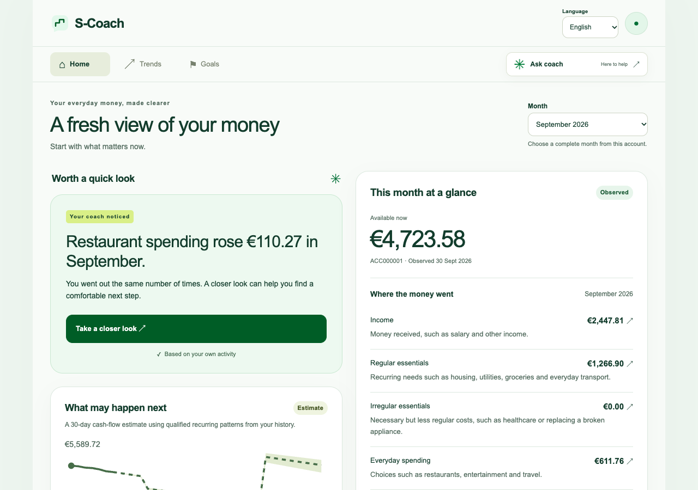
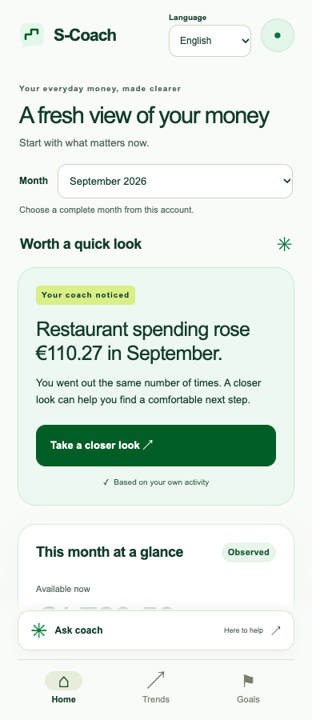
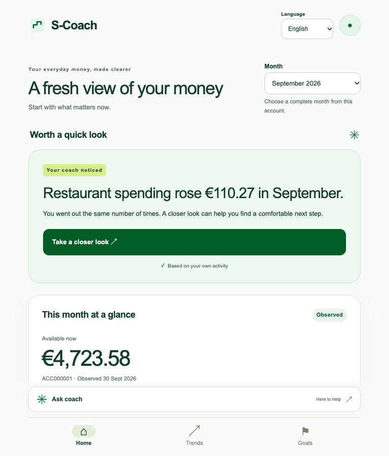
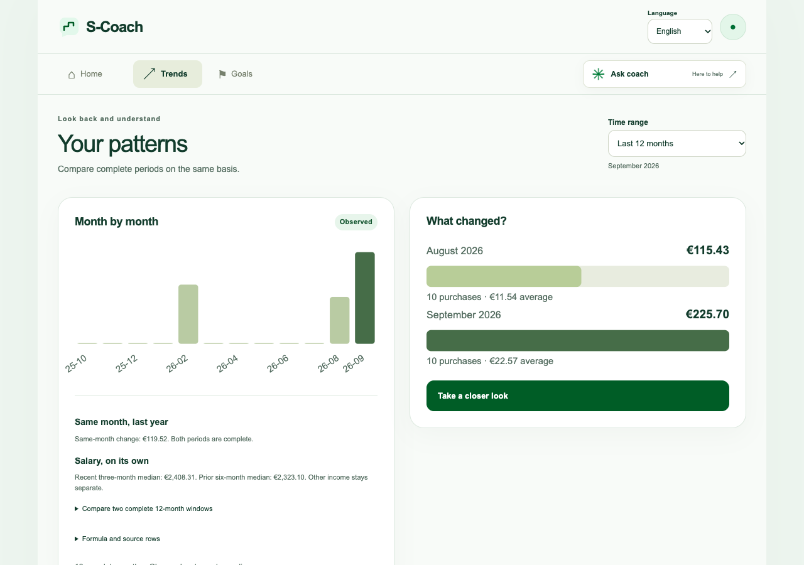

# S-Coach — talk with your money

S-Coach is a mobile-first, desktop-adaptive financial coach for the Junction 2026 S-Pankki challenge. It turns the official synthetic banking dataset into plain-language answers, explainable visualizations, editable planning scenarios, and goal guidance.

The prototype runs locally by default. It uses no real customer data, makes no payments or credit decisions, and requires no third-party package for its core flow.

**Current status:** V2 has four primary pages—Home, Spending, Coach and Goals—with one spending ring, a full conversation page, title-only wishes and three guided customer stories. WP1, WP2 and WP6 connect the tool-calling agent, bounded conversation history and mobile chat. Current Coach acceptance covers 375×812, 390×844 and 1280×800 in Chrome, including three exchanges, evidence and confirmation flows. A real three-turn DeepSeek smoke check passed on synthetic data. Broader usability, other browser engines and live Gemini generation remain unverified; see the [development log](docs/DEVELOPMENT_LOG.md).

### Agent chat (WP1, WP2 and WP6)

The Coach page calls `POST /api/agent`, a function-calling backend for DeepSeek and Gemini with read-only calculation tools, a numeric provenance check and an automatic offline fallback. It accepts up to eight previous user/coach text messages, each at most 600 characters. Previous tool results are not replayed; the model calls tools again for fresh account facts. Deterministic responses use the existing `/api/coach` renderer and calculation flows.

The frontend request helper `createAPI(customerId).agent(message, {month, locale, conversation})` extracts only visible text from the matching customer/month/language, drops older messages and clips text without changing the displayed conversation. New-chat and scope-change resets clear the source conversation. The page retains at most twenty exchanges and does not persist transcripts. Explicit preference declarations keep their local consent flow.

Coach uses a compact account/month bar, a separately scrolling message area and a multiline composer above navigation. Enter sends; Shift+Enter adds a line. Agent responses show plain text, verified highlights/charts, expandable steps and transaction sources, and suggestions on the latest answer. Goal proposals open the editable planner; spending scenarios require a separate confirmation before saving. The mode line distinguishes an agent answer from offline coaching. The developer-only `/device-preview.html` includes 375×812, 390×844 and desktop presets.

The server loads `s bank/.env` at startup without overriding existing shell variables. Configure `DEEPSEEK_API_KEY` and optionally `DEEPSEEK_MODEL` (default `deepseek-flash`). DeepSeek takes priority when its key is present; otherwise the agent uses `GEMINI_API_KEY` and `GEMINI_MODEL` (default `gemini-3-flash-preview`). This file is ignored by Git. Model selection is configurable, but another model's availability and latency must be verified against the same tool loop. No SDK or backend dependency is required.

The agent permits at most six model turns, twenty tool calls and a twenty-five-second execution budget. Money calculations use the existing ledger services or a restricted decimal calculator. Charts and highlight cards reference server-created tool results. Proposed goals and scenarios are never saved by the model: they must pass through the existing customer-confirmed POST endpoints.

The number check detects unsupported numeric tokens; it is not a proof that every sentence gives those numbers the correct meaning. It also accepts customer-provided figures and documented date/count exceptions. Unknown benchmarks remain unavailable. Forecasts remain estimates, and this backend does not provide investment, credit or tax advice.

WP1 live smoke checks with `deepseek-flash` passed on a temporary synthetic ledger: restaurant spending of EUR 225.70 and a 20% reduction of EUR 45.14 monthly / EUR 541.68 annually, each using two model calls in under three seconds. This verifies those two paths, not broad conversational quality. An earlier Gemini attempt returned HTTP 402 (`RESOURCE_EXHAUSTED`, exhausted project prepayment credits) and exercised the offline fallback. Automated tests use scripted responses and temporary synthetic databases.

## What the prototype demonstrates

- **A clear financial home:** the last recorded balance and its date, one coaching action, three teaching baskets and a compact goal/wish summary. Spending owns the single interactive category ring and matching transaction details. Income and saving transfers stay separate from consumption; forecast, investment and VAT details are optional expansions.
- **A complete Coach page:** a persistent conversation, visible account/date scope, starter questions, factual prose and recoverable errors. Calculation cards and charts support the answer through optional disclosures; earlier scenario actions remain attached to their original result. Home, Spending, Coach and Goals are the four primary destinations; Journal and notebook remain secondary. First-time visitors can try a short, skippable three-step tour and replay it later.
- **Personalization with control:** choose a life goal, coaching style and spending to protect. Preferences work for the current visit; remembering them on this browser requires opt-in. Explicit conversational preferences produce a proposal for confirmation, never an automatic memory write.
- **An editable notebook and financial journal:** add, edit or delete notes and revoke remembering. Structured goals and protected-spending choices guide current suggestions. Free-form notes are personal reflections for the user, not model instructions. The journal describes recorded income, housing payments and the largest purchase without inventing a biography.
- **Goals at the customer's pace:** keep a wish with a title alone, explore it with Coach, then optionally supply an amount and date for a numeric plan. Wishes follow the same session-only/browser-memory consent as preferences. Optional milestones reflect the saved amount the customer entered; viewing or linking a scenario does not create saving progress or move money.
- **Defined questions and exact calculations:** supported EN/FI/SV queries resolve category or merchant code, account, dates and metric before local calculations. Bounded follow-ups reuse a validated scope. Missing definitions or unavailable item details prompt clarification. Matching evidence follows the returned dates and filters.
- **Planning with visible assumptions:** seven-day safe-to-spend, an explicitly labelled 30-day balance forecast, dining-reduction scenarios and goal pace. Plain summaries lead; calculations and evidence are available on demand, with technical hashes kept out of normal customer copy.
- **Additional source-backed views:** observed investment transfers, optional linked historical mortgage context, explicit tax-record evidence, user-declared tax planning, and an estimated VAT-inside-purchases lens.
- **One responsive application:** phone, tablet and desktop layouts, complete EN/FI/SV interface copy, and a local viewport preview utility. Optional Gemini can assist with additional query languages; live arbitrary-language behavior remains unverified.

The current information hierarchy is recorded in [EXPERIENCE_V2_PLAN.md](docs/EXPERIENCE_V2_PLAN.md). Earlier design rationale and references to S-mobiili, Nordea, Monzo and Apple remain in [REDESIGN_PLAN.md](docs/REDESIGN_PLAN.md). [USER_TEST_JOURNEYS.md](docs/USER_TEST_JOURNEYS.md) defines eight customer journeys and 40 turns that evaluate usefulness, scope, readability and control; it is not a claim that human usability testing has already passed.

## Interface examples

<details>
<summary>Earlier prototype screenshots — before the current redesign</summary>

**These four images show the prior interface, captured on 14 November 2026. They do not show the V2 four-page layout, Coach page or wishes.** They are retained as historical project examples using synthetic data; current WP6 browser verification is recorded separately in the development log.

### Earlier desktop overview



### Earlier phone and tablet

| Phone · 390 px | Tablet · 768 px |
|---|---|
|  |  |

### Earlier trends and comparison



</details>

To explore the current interface, [start the app](#quick-start), then open the [local device preview](http://127.0.0.1:8088/device-preview.html).

## Quick start

Run all commands below from the **repository root**, `Junction_Hannah_family/`, in bash or zsh. This application is self-contained under `s bank/`; the root Stoa backend and `web/` server are not needed.

### Requirements

- Python 3.10 or newer, with the standard-library `sqlite3` module. The current environment was checked with Python 3.13.12.
- A modern browser. Node.js is used for JavaScript checks in the test suite, not for running the app.
- No `pip install`, `npm install`, system-package installation, or Gemini key is needed for the core demo.

### Start with the existing demo database

If `s bank/var/scoach.sqlite3` is already present and imported, reuse it. **Do not rebuild or replace it just to start the app.**

```bash
PYTHONPATH="s bank" python3 -m scoach \
  --db "s bank/var/scoach.sqlite3" \
  --host 127.0.0.1 --port 8088
```

Keep this terminal running. Open:

- [App](http://127.0.0.1:8088/)
- [Phone / tablet / desktop preview](http://127.0.0.1:8088/device-preview.html): choose a preset on the left; orientation and fit controls are available.
- [Health](http://127.0.0.1:8088/api/health)

Stop the server with **Ctrl+C** in that terminal. The server is local to this computer; opening `127.0.0.1` on a separate phone will not reach it. The preview page changes viewport sizes, not the browser or operating system.

### First run on a fresh checkout: obtain the data

Download the four CSV files from the [official Junction S-Pankki repository](https://github.com/hackjunction/Junction-2026-S-pankki) into:

```text
s bank/junction-dataset/
  tx_customers_junction.csv
  tx_junction_transactions.csv
  mtg_negotiation_history.csv
  mtg_tx_customer_link_and_final_mtg_infio.csv
```

The raw dataset and generated database are ignored by Git, so cloning this application alone does not include them. Reuse the existing files if already downloaded. Never commit raw challenge data.

### First run only: build a demo database

```bash
python3 "s bank/scripts/build_demo_db.py" \
  --source "s bank/junction-dataset" \
  --output "s bank/var/scoach.sqlite3"
```

This streams the full transaction CSV and selects six demo personas; allow the import to finish before starting the server. Then use the start command above. The importer refuses to import over a database with a completed import.

To test a rebuild, use an unused output filename such as `s bank/var/scoach-rebuilt.sqlite3` and pass that same path with `--db` when starting. Keep the existing database and its saved demo state.

### Check startup and troubleshoot

```bash
curl --fail http://127.0.0.1:8088/api/health
curl --fail http://127.0.0.1:8088/api/personas
```

The JSON envelope contains `ok` and `data`. Health reports file presence as `data.database_ready`, not full database integrity. The personas route should list Alex, Robin, Sam, Jules, Taylor, and Kai for the current imported database.

| Symptom | Check |
|---|---|
| `No module named scoach` | Run from the repository root with `PYTHONPATH="s bank"`. |
| Missing database / empty demo | Complete the import and check the `--db` path. |
| `Address already in use` | Open the existing local demo first, or choose `--port 8089` and use that port in the URLs. |
| Connection refused | Keep the server terminal running and check its printed URL. |
| Missing Kai persona | The database may be from an older import. Build to a new filename and start with that file. |

## Optional model configuration

The guided demo works without an API key, subject to the known question limitations below. Create or edit the ignored `s bank/.env` with the provider you intend to use:

```dotenv
DEEPSEEK_API_KEY=your-key
DEEPSEEK_MODEL=deepseek-flash
# Alternatively, omit the DeepSeek key and configure Gemini:
# GEMINI_API_KEY=your-key
# GEMINI_MODEL=gemini-3-flash-preview
```

The command-line server loads this file at startup. Existing shell variables take precedence. Restart after changing configuration:

```bash
PYTHONPATH="s bank" python3 -m scoach \
  --db "s bank/var/scoach.sqlite3" --host 127.0.0.1 --port 8088
```

Health configuration flags only mean credentials are present; they do not prove the remote model works. DeepSeek generation has passed the documented synthetic smoke checks. Gemini's last generation attempt was quota-blocked. Additional languages and broader conversational quality still need live evaluation.

Never commit a real key. The agent receives sanitized conversation text and bounded tool results; local evidence references reopen transactions in the client. Python performs financial calculations, and the number checker rejects unsupported numeric tokens. A bounded failure returns a deterministic answer with a diagnostic fallback reason. Model access does not add missing receipt items, holdings, verified tax liabilities or unrestricted conversation memory.

## Tests

```bash
PYTHONPATH="s bank" python3 -m unittest discover -s "s bank/tests" -v
```

HTTP integration tests need permission to bind a local test port. JavaScript checks use Node.js and are skipped when it is unavailable. No package installation is needed for the core Python tests. The current rendered chat test needs an existing Playwright installation and Chrome:

```bash
SCOACH_CHAT_PLAYWRIGHT_PATH="/absolute/path/to/node_modules/playwright" \
  PYTHONPATH="s bank" python3 -m unittest discover -s "s bank/tests" -q
```

The chat test creates a temporary synthetic database, scripts agent responses at the HTTP boundary and exercises real layout, keyboard sending, pending state, suggestion history, exact evidence, confirmed scenario saving, editable goal proposals and scope resets. `SCOACH_SCREENSHOT_DIR` optionally saves rendered phone/desktop captures. The older pre-redesign browser flow is separately opted in with `SCOACH_PLAYWRIGHT_PATH`; it is not part of the current rendered chat acceptance.

Latest WP6 verification on 15 November 2026: **417 tests passed and one older optional browser flow skipped**, out of 418 discovered, including the new rendered chat test. Details are in the [development log](docs/DEVELOPMENT_LOG.md). After the native browser-control tool became unreliable, the user authorized a temporary Playwright installation. It used existing Chrome without changing project dependencies. Real DeepSeek checks are separate from scripted browser and minimal-DOM tests; neither establishes general conversational quality or human usability.

## Try the demo

Use **Try a story** to start Kai's weekly spending estimate, Alex's dining scenario, or Taylor's historical home-financing context. These are three real paths through the same data tools; Taylor's source records do not establish a current mortgage or family repayments. For the questions below select **Alex → September 2026 → English**, then open **Coach**. Values assume the original demo classification; saved user corrections can affect derived results. For a follow-up, ask `And groceries?` after the restaurant question; choose **Start a new question** to clear that context:

| Question | Expected result |
|---|---|
| `I want to go see a movie this week` | Ask for the total budget; a plain `€20` reply continues this plan using the displayed historical account snapshot |
| `How much did I spend on restaurants?` | EUR 225.70 across 10 purchases |
| `How much did I spend on groceries?` | EUR 379.79 across 5 purchases |
| `How much did I spend on restaurants in August 2026?` | EUR 115.43 across 10 purchases, even with September selected |
| `How much did I spend on taxis in September 2026?` | No identified MCC 4121 rows; do not describe all Transportation as taxis |
| `How much could I save if I reduced dining out by 20%?` | EUR 45.14, an unsaved scenario |
| `How much could I save if I reduced dining out by 12.5%?` | EUR 28.21, using the complete decimal percentage |
| `How much could I save if I reduced dining out by twenty percent?` | EUR 45.14; common EN/FI/SV number words are supported |
| `How much VAT is inside my purchases in September?` | Approximately EUR 212.38, with period, coverage, limitations and source records |
| `What kind of spender am I?` | The three spending baskets, not a personality score |
| `What is safe for me to spend this week?` | EUR 3,288.31 under the displayed demo assumptions |
| `How much tax did I pay?` | Explicit tax evidence unavailable, not zero tax paid |
| `I want to save for a car.` | Exploratory guidance; keep a title-only wish, then optionally open the numeric planner |

The safe-to-spend example uses the data reference date **2026-09-30**, a seven-day horizon, and a EUR 500 reserve. It does not refer to the real current week. The month selector supplies the reference clock; supported explicit month and ISO-range questions can select a different historical period. Switch to Kai to inspect the young-adult payday story. See [DEMO_SCRIPT.md](docs/DEMO_SCRIPT.md) for the longer walkthrough.

## Known limitations

- **Bounded tools:** the agent can compose the available read-only calculations; offline coaching supports defined query patterns. Supported merchant codes identify taxis, pharmacies and doctors; the data cannot reveal receipt items or specific brands. Empty merchant-code results mean no identified rows, not proof of no real-world spending.
- **Dates and definitions:** dates and filters must be supported by the selected calculation tool. The offline path resolves its supported month/range expressions locally and asks for clarification for unsupported definitions. Numeric provenance alone does not establish semantic correctness.
- **Conversation scope:** the agent receives at most eight recent text messages, scoped to customer, month and language. Tool results are refreshed each request. The page retains twenty exchanges until reset; this is not long-term transcript memory. Offline follow-ups retain their bounded validated-query behavior.
- **Personalization:** remembered preferences and notes are browser-local demo data, without real authentication. A shared browser can expose that profile. Only structured preferences guide current suggestions; free-form reflections are not sent as model instructions. Storage failures are disclosed, including failure to delete saved data.
- **Data boundaries:** the source does not establish gross income tax, investment performance, individual holdings, current loan approval, or personal motivations. Forecasts and safe-to-spend remain planning estimates.
- **Language and verification:** the interface supports EN/FI/SV. Broader live query-language quality remains unverified with either provider. Human usability and native mobile keyboard/safe-area behavior require separate device checks.

See the [40-turn customer acceptance guide](docs/USER_TEST_JOURNEYS.md) for expected definitions, clarifications, multi-turn behavior, privacy choices and useful next actions. Exact SQL sums alone cannot establish that the intended question was answered.

## Main evidence checks

For `CUST00001`, September 2026:

| Check | Verified result |
|---|---:|
| Restaurant spending | EUR 225.70 across 10 purchases |
| August restaurant spending | EUR 115.43 across 10 purchases |
| Change | EUR 110.27 |
| Read-only 20% dining scenario | EUR 45.14 |
| Scenario after excluding the EUR 36.47 one-off | EUR 37.85 from a EUR 189.23 base |
| Transportation | EUR 266.80 across 6 transactions |
| Estimated VAT inside EUR 1,878.66 spending | approximately EUR 212.38 |
| Regular essentials after partner-aligned mapping | EUR 1,266.90 |
| Irregular essentials | EUR 0.00 |
| Everyday discretionary | EUR 611.76 |
| Saving and transfers | EUR 235.72 |

Actual spending never changes when a scenario is edited.

## Data and AI boundaries

- The transaction CSV contains signed amounts, balances, categories, types, merchant IDs, and MCC codes for 5,100 synthetic customers across 24 months.
- Money is stored and calculated in integer cents with explicit half-up rounding.
- Structured customer, account, date, and filter parameters are checked server-side. That validation does not establish that a natural-language question was mapped to the intended scope.
- Source transactions are immutable; corrections, scenarios, goals, exclusions, and audit events live separately.
- The three teaching baskets follow the partner definition. Groceries and transport are regular essentials; health and Home & Tech are irregular essentials; restaurants and similar choices are everyday spending. Customers can correct a classification.
- Safe-to-spend and cash-flow outputs are planning estimates, not guarantees or probability forecasts.
- VAT is an approximate component of gross purchase prices based on date and a versioned MCC/category map. Mapping coverage is not an accuracy score; broad rows are labelled and ambiguous unsupported rows remain uncovered. It is an estimate over observed purchases, not a planning scenario, tax liability, or filing calculation.
- Net salary cannot establish Finnish gross income tax. Income-tax planning therefore uses only customer-entered amounts and dates.
- Mortgage records are historical synthetic context, not loan advice, an offer, or an approval prediction.

## Project map

```text
scoach/                  Python domain logic and local API
scripts/build_demo_db.py Streaming importer for selected personas
web/                     Responsive dependency-free client
tests/                   Unit, API, privacy, localization, and browser contracts
docs/PROJECT_DESIGN.md   Product decisions and calculation rules
docs/REDESIGN_PLAN.md    Current interaction design and research references
docs/USER_TEST_JOURNEYS.md Customer-benefit and multi-turn acceptance cases
docs/PIPELINE.md         Data provenance and current implementation status
docs/API.md              Local endpoint contract
docs/TECHNICAL_DOCUMENTATION.md
docs/DEVELOPMENT_LOG.md
docs/DEMO_SCRIPT.md      Short judge walkthrough
```

## Deployment position

The submitted prototype is local-first: one Python process serves JSON and static files on loopback. The same application could be containerized behind S-Pankki authentication and consent controls, but production authentication, authorization, encryption key management, retention, rate limiting, bank-host callbacks, payments, and regulatory review are intentionally not claimed here.

The visual system aligns with public S-mobiili cues—clear hierarchy, green/white surfaces, rounded shapes, and selective bright-green accents—while using an original S-Coach mark rather than copying S-Pankki's protected logo.
